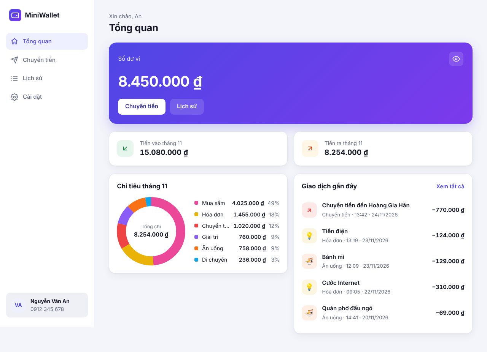
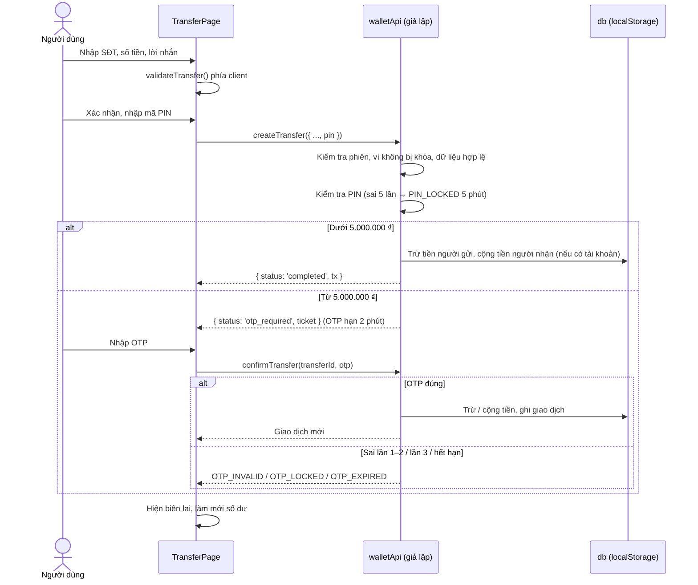

# MiniWallet – Ví điện tử mini

Ứng dụng web mô phỏng ví điện tử: đăng nhập bằng **số điện thoại + mã PIN**, xem số dư, thống kê chi tiêu, tra cứu lịch sử giao dịch và **chuyển tiền có xác thực PIN/OTP**.
Dữ liệu là giả lập và chạy hoàn toàn trên trình duyệt, nên không cần backend: tải về là chạy được, deploy chỉ cần một bước.

> Demo: _(thêm link Vercel sau khi deploy)_ · Tài khoản dùng thử: **0912 345 678**, PIN **147258** (có nút "Điền sẵn" ở trang đăng nhập)



## Tính năng

**Đăng nhập, đăng ký và bảo mật**
- Đăng ký bằng họ tên, số điện thoại và mã PIN 6 số. Không cho dùng PIN dễ đoán (`111111`, `123456`...). Tài khoản mới được tặng 500.000 ₫.
- Mã PIN được **băm bằng PBKDF2-SHA256** (100.000 vòng, salt riêng cho từng tài khoản) qua Web Crypto. Không lưu PIN dạng chữ thường.
- **Sai PIN 5 lần thì khóa 5 phút**, áp dụng cho cả đăng nhập lẫn xác nhận giao dịch.
- Phiên đăng nhập hết hạn sau 30 phút không thao tác, mỗi lần gọi API thì được gia hạn. Hết hạn thì tự về trang đăng nhập, đăng nhập lại thì quay về đúng trang đang xem.
- **Khóa ví khẩn cấp**: khóa ngay không cần PIN, mở khóa phải nhập PIN. Khi đang khóa, server chặn mọi giao dịch trừ tiền.
- Đăng nhập sai số điện thoại hay sai PIN đều nhận cùng một thông báo, để không lộ số nào đã đăng ký.

**Tổng quan**
- Số dư ví, có nút ẩn/hiện. Trạng thái ẩn được nhớ cho lần mở sau.
- Tổng tiền vào, tiền ra trong tháng.
- Biểu đồ tròn chi tiêu theo danh mục, **tự vẽ bằng SVG**, không dùng thư viện biểu đồ.
- 5 giao dịch gần nhất.

**Lịch sử giao dịch**
- Tìm kiếm **không phân biệt dấu**: gõ "ca phe" vẫn ra "Cà phê sáng". Tìm được theo tên, lời nhắn và số điện thoại.
- Lọc theo loại (tiền vào/ra), danh mục và khoảng ngày.
- Có phân trang, giao dịch được gom theo ngày.
- Bộ lọc **lưu trên URL** (`?q=&type=&page=`): tải lại trang hoặc bấm Back vẫn giữ nguyên, và có thể gửi link cho người khác.
- Chờ người dùng ngừng gõ 300 ms mới tìm (debounce), không gọi API theo từng phím.
- Trang chi tiết riêng cho từng giao dịch (`/transactions/:id`).

**Chuyển tiền:** nhập thông tin → xác nhận → nhập PIN → nhập OTP (chỉ khi từ 5.000.000 ₫)
- Chọn nhanh người nhận từ danh bạ, chọn nhanh số tiền. Ô số tiền tự thêm dấu chấm khi gõ (`1.250.000`).
- Kiểm tra dữ liệu: số điện thoại Việt Nam hợp lệ, không chuyển cho chính mình, tối thiểu 10.000 ₫, tối đa 50.000.000 ₫/lần, không vượt số dư, lời nhắn tối đa 100 ký tự.
- Mọi giao dịch cần mã PIN. Giao dịch **từ 5.000.000 ₫** cần thêm OTP 6 số: hết hạn sau 2 phút, gửi lại được sau 30 giây, **sai 3 lần thì giao dịch bị hủy.**
- Chuyển tới số điện thoại đã đăng ký MiniWallet thì người nhận được cộng tiền và thấy giao dịch "Nhận tiền".
- "Server" giả lập kiểm tra lại toàn bộ dữ liệu, không tin hoàn toàn vào form.
- Có biên lai sau khi chuyển thành công. Số dư và lịch sử tự cập nhật.

**Cài đặt:** đăng xuất, khóa/mở khóa ví, chế độ sáng/tối (mặc định theo hệ điều hành), ẩn số dư, khôi phục dữ liệu mẫu (có hộp thoại xác nhận).

**Chất lượng giao diện**
- Responsive: máy tính dùng thanh bên, điện thoại dùng thanh điều hướng dưới đáy.
- Đủ trạng thái **đang tải (skeleton) / rỗng / lỗi (có nút thử lại)** ở mọi màn hình.
- Truy cập được bằng bàn phím và trình đọc màn hình: nhãn cho mọi ô nhập, lỗi gắn với ô qua `aria-describedby`, hộp thoại đóng bằng Esc và trả focus về chỗ cũ, link "Bỏ qua tới nội dung chính", tôn trọng cài đặt giảm chuyển động.

| Chế độ tối | Xác thực OTP | Điện thoại |
|---|---|---|
|  |  |  |

## Công nghệ

| | |
|---|---|
| Ngôn ngữ | TypeScript (`strict`, `noUncheckedIndexedAccess`) |
| Giao diện | React 18 (function component + hooks), Vite |
| Điều hướng | React Router 6 (route lồng nhau, route cần đăng nhập, tham số `:id`, `useSearchParams`) |
| Quản lý state | Context API + `useReducer` (`AuthContext` cho đăng nhập, `WalletContext` cho ví; luồng chuyển tiền là một máy trạng thái riêng) |
| Gọi dữ liệu | API giả lập trả về Promise có độ trễ 0,3–0,7 giây và lỗi có mã (`ApiError`), cùng hook `useAsync` tự viết |
| Lưu trữ | `localStorage` (có xử lý khi trình duyệt chặn) |
| Giao diện | CSS thuần + CSS variables cho chế độ sáng/tối, không dùng thư viện UI |
| Bảo mật (mô phỏng) | Web Crypto: PBKDF2 để băm PIN, `getRandomValues` cho salt và token |
| Kiểm thử | Vitest: 68 test cho hàm định dạng, validate, khóa PIN, reducer, đăng nhập/phiên và toàn bộ luồng chuyển tiền của API |

Chỉ dùng 3 thư viện khi chạy: `react`, `react-dom`, `react-router-dom`.

## Cài đặt và chạy

Yêu cầu Node.js 18 trở lên.

```bash
npm install
npm run dev      # mở http://localhost:5173
npm test         # chạy test
npm run typecheck # kiểm tra kiểu TypeScript
npm run build    # kiểm tra kiểu rồi build production vào thư mục dist/
npm run preview  # xem thử bản build
```

## Các tình huống để thử

| Muốn thử | Cách làm |
|---|---|
| Đăng nhập nhanh | Trang đăng nhập → "Điền sẵn" (0912 345 678 / 147258) |
| Chuyển tiền nhỏ | Chọn một người trong danh bạ, nhập số tiền dưới 5 triệu, nhập PIN là xong |
| Chuyển tiền lớn (cần OTP) | Nhập từ 5.000.000 ₫, sau PIN lấy mã OTP trong khung "Tin nhắn giả lập" |
| Sai PIN 5 lần | Nhập sai PIN 5 lần ở bước PIN hoặc trang đăng nhập: bị khóa 5 phút |
| Chuyển giữa 2 tài khoản | Đăng ký tài khoản mới → đăng xuất → đăng nhập demo, chuyển tới số mới → đăng nhập lại tài khoản mới để thấy tiền về |
| Khóa ví khẩn cấp | Cài đặt → Khóa ví khẩn cấp, rồi thử chuyển tiền; mở khóa bằng PIN |
| Hết phiên đăng nhập | Để yên 30 phút rồi thao tác, hoặc xóa key `miniwallet:token` trong localStorage |
| Lỗi validate | Bấm "Tiếp tục" khi chưa nhập gì, hoặc nhập số tiền lớn hơn số dư |
| Sai OTP 3 lần | Với giao dịch lớn, nhập sai mã 3 lần: giao dịch bị hủy và quay về bước đầu |
| Lỗi máy chủ | Chuyển tới số **0999999999** |
| Người nhận chưa có trong danh bạ | Nhập một số hợp lệ bất kỳ, màn xác nhận sẽ hiện cảnh báo |
| Dữ liệu ban đầu | Cài đặt → Khôi phục dữ liệu mẫu (xóa mọi tài khoản đã đăng ký) |

## Luồng chuyển tiền



Các bước của form được quản lý bằng reducer (`components/transfer/transferReducer.ts`):

```
form ─Tiếp tục─▶ confirm ─Tiếp tục─▶ pin ─PIN đúng, < 5 triệu─────────────────▶ success
 ▲                │  ▲                │  └─PIN đúng, ≥ 5 triệu─▶ otp ─OTP đúng─▶ success
 └───Quay lại─────┘  └───Quay lại─────┘                          │
 ▲                                                               │
 └─────── Hủy / sai OTP 3 lần / PIN bị khóa / ví bị khóa ────────┘
```

## Cấu trúc thư mục

```
src/
├── api/
│   ├── db.ts                 # "Cơ sở dữ liệu" nhiều tài khoản: bộ nhớ + localStorage, chuyển dữ liệu v1 → v2
│   ├── server.ts             # Phía server: độ trễ, kiểm tra phiên đăng nhập, kiểm tra PIN
│   ├── session.ts            # Phía client: giữ token, báo khi phiên hết hạn (như interceptor 401)
│   ├── authApi.ts            # Đăng ký, đăng nhập, đăng xuất, khóa/mở khóa ví
│   ├── walletApi.ts          # Số dư, giao dịch, chuyển tiền (PIN + OTP)
│   └── errors.ts             # ApiError và các mã lỗi
├── components/
│   ├── auth/                 # AuthLayout, PinInput, RequireAuth / GuestOnly
│   ├── common/               # Button, Field, Modal, Switch, Money, Pagination, States...
│   ├── charts/DonutChart.tsx # Biểu đồ tròn SVG
│   ├── layout/Layout.tsx     # Thanh bên / thanh dưới + <Outlet />
│   ├── transaction/          # TransactionItem
│   └── transfer/             # Các bước chuyển tiền + transferReducer
├── context/
│   ├── AuthContext.tsx       # Trạng thái đăng nhập + hook useAuth()
│   ├── WalletContext.tsx     # Provider + hook useWallet()
│   └── walletReducer.ts
├── data/                     # Danh mục, dữ liệu mẫu (sinh ngẫu nhiên có seed cố định)
├── hooks/                    # useAsync, useNow, useTheme
├── pages/                    # Login, Register, Dashboard, Transactions, TransactionDetail, TransferPage, Settings, NotFound
├── styles/                   # base.css (biến màu, bố cục), components.css, pages.css
├── utils/                    # format, validators, lọc/thống kê, crypto (băm PIN), security (khóa PIN)
└── types.ts                  # Kiểu dữ liệu dùng chung: Transaction, Database, OtpTicket...
```

Test nằm cạnh file được test (`*.test.ts`).

## Một số quyết định khi làm

- **Tách logic khỏi giao diện.** Định dạng, validate, lọc và thống kê là hàm thuần trong `utils/`, nên test dễ mà không cần render component. Hàm `validateTransfer` dùng chung cho form và "server".
- **API giả lập nhưng hành xử như thật.** Có độ trễ, lỗi có mã, và kiểm tra lại dữ liệu ở server. Nhờ vậy giao diện phải xử lý đủ loading và lỗi. Muốn nối backend thật thì chỉ cần thay `api/walletApi.ts`, các trang giữ nguyên.
- **Tránh hiện sai dữ liệu khi đổi bộ lọc nhanh.** `useAsync` bỏ qua kết quả của lần gọi cũ nếu đã có lần gọi mới hơn.
- **Để TypeScript chặn trạng thái sai.** Action của reducer là union có phân biệt (discriminated union), mã lỗi API là kiểu liệt kê `ApiErrorCode`, và dữ liệu đọc từ URL hay localStorage được kiểm tra trước khi dùng (`isCategoryKey`, `isDatabase`).
- **Bảo mật đặt ở "server", giao diện chỉ báo sớm.** Kiểm tra PIN, khóa PIN và khóa ví nằm trong API. Giao diện có ẩn nút hay không thì gọi thẳng API vẫn bị chặn. Dữ liệu được kiểm tra trước PIN, nên gõ sai số tiền không làm mất lượt thử PIN.
- **Biết giới hạn của bản mô phỏng.** PIN 6 số chỉ có 1 triệu khả năng nên băm không đủ để chống dò; thứ thực sự bảo vệ là giới hạn số lần sai, và ở hệ thống thật việc này phải làm ở server. Token đang để trong localStorage vì không có server; thực tế nên dùng cookie `httpOnly` để mã XSS không đọc được.
- **Mỗi lần đăng nhập là một state ví mới.** `WalletProvider` nằm trong vùng đã đăng nhập, nên đăng xuất rồi đăng nhập tài khoản khác không bị sót dữ liệu của người trước.
- **Tiền luôn là số nguyên (đồng).** Chỉ định dạng khi hiển thị, tránh lỗi làm tròn số thực.

## Deploy lên Vercel

1. Đưa code lên GitHub.
2. Vào [vercel.com](https://vercel.com), chọn **Add New → Project** rồi chọn repo. Vercel tự nhận Vite (build: `npm run build`, output: `dist`).
3. File `vercel.json` đã cấu hình để các đường dẫn như `/transactions/abc` không bị lỗi 404 khi tải lại trang.

## Hướng phát triển

- Thêm test giao diện với React Testing Library.
- Nối với backend thật (Spring Boot + JWT).
- Thêm tính năng nạp/rút tiền và xuất lịch sử ra CSV.
- Đổi mã PIN, quên mã PIN (xác thực lại bằng OTP).
